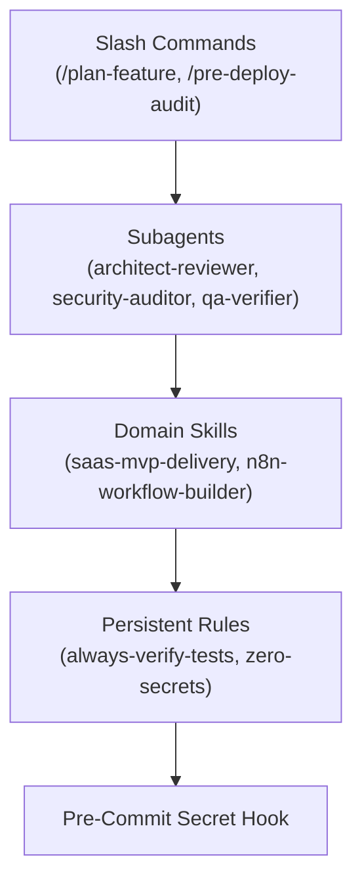

# Claude Code Agency Toolkit (Subagents, Skills, Hooks & MCP Configs)

[](https://github.com/agenciaiaonline-wq/claude-code-agency-toolkit/actions/workflows/ci.yml)
[](.claude/)
[](mcp_config.example.json)
[](LICENSE)

> **Modular subagents, reusable skills, slash commands, pre-commit secret hooks, and sanitized MCP server configurations engineered for shipping client AI & SaaS software rapidly.**

Inspired by leading community agent engineering repositories (`everything-claude-code`, `claude-code-templates`), this drop-in `.claude/` starter codifies repeatable review gates so solo engineers and agencies maintain production discipline at AI speed.

---

## Toolkit Architecture



---

## What Is Included

| Layer | Files | Purpose |
| :--- | :--- | :--- |
| **Subagents** | `.claude/agents/*.md` | Isolated specialist personas with scoped tool permissions |
| **Skills** | `.claude/skills/*/SKILL.md` | Repeatable delivery playbooks for SaaS MVPs and n8n automation |
| **Commands** | `.claude/commands/*.md` | Explicit `/plan-feature` and `/pre-deploy-audit` workflows |
| **Rules & Hooks** | `.claude/rules/*.md`, `.claude/hooks/` | Automated test-gate and zero-secret enforcement |
| **MCP Template** | `mcp_config.example.json` | Sanitized Playwright, Context7, PostgreSQL & GitHub MCP config |
| **Installer** | `scripts/install_toolkit.sh` | One-command setup into any repository |

---

## Quick Start

```bash
# Install into an existing repository
chmod +x scripts/install_toolkit.sh
./scripts/install_toolkit.sh /path/to/your-project

# Validate toolkit structure & secret hook locally
python3 -m unittest discover -s tests -v
```

---

## Custom AI Engineering Team Enablement (`USD 3,000 - 10,000`)
- **LinkedIn Studio:** [Golden Nodalix Studio](https://www.linkedin.com/in/agency-golden-nodalix-880598438/)
- **Profile Hub:** [agenciaiaonline-wq](https://github.com/agenciaiaonline-wq)
- **Email:** `studio@example.com`
